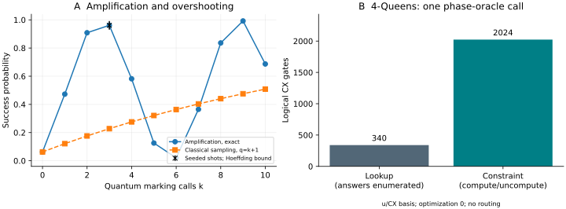

# Amplitude Amplification: From Reflections to Reversible Constraints

A compact, reproducible implementation of Grover search and general amplitude amplification. The notebook exposes phase marking, reflection about a prepared state, iteration selection, reversible workspace, and the difference between oracle queries and circuit cost. It demonstrates an established algorithm; it does not claim a new quantum speedup or hardware result.

## Reproduce

Python 3.11, from this directory:

```bash
python -m venv .venv
source .venv/bin/activate
python -m pip install -r requirements.txt
python run_checks.py
```

Acceptance runs the scientific tests, four measured simulator cases, and the notebook in a fresh kernel. Derived JSON and the executed notebook go to ignored `artifacts/validation/`. Python experiment socket connections are disabled. No external backend, credentials, or paid API is used. CI repeats acceptance in the dedicated pinned environment; the shared structural check alone is insufficient.

## Scientific design

For `A|0⟩=|ψ⟩`, the circuit implements `Oχ=I−2Πgood`, `D_A=2|ψ⟩⟨ψ|−I`, and `Q=D_A Oχ`. Exact success after k iterations is `sin²((2k+1) asin(√p))`. The chosen iteration count maximizes success among the integers adjacent to the first continuous peak; it is not a global search over later peaks. Ties and empty/full marked sets choose zero iterations. This policy assumes known p.

[The notebook](Grovers_Algorithm_for_Quantum_Search_and_Acceleration.ipynb) contains the invariant-plane derivation and compact circuits. [amplification.py](amplification.py) implements the gates; an independent NumPy reflection supplies the complete complex statevector reference. Bitstrings use Qiskit's most-significant-bit-first display, with qubit 0 least significant.

| Case | Evidence |
| --- | --- |
| Five-qubit search, two marked states | Analytic/exact/seeded-shot agreement and visible overshooting |
| Nonuniform complex three-qubit preparation | Reflection uses the actual A and its inverse; full amplitude comparison |
| 4-Queens constraint oracle | Eight system qubits plus six pair-conflict flags; compute–phase–uncompute, with no complete-solution enumeration inside the oracle |
| 5-Queens lookup oracle | Fifteen system qubits, ten pre-enumerated targets; explicit distinction between 32,768 binary assignments and 3,125 in-range boards |

The classical references use both exhaustive enumeration and independent backtracking. They determine M for these small known-success benchmarks. The constraint oracle itself checks local column/diagonal conflicts without loading the solutions. The five-Queens oracle deliberately retains the original lookup approach; its preparation already knows the answers and cannot substantiate a search advantage.

## Acceptance and interpretation

- Compare full complex amplitudes with an independent reflection reference: L2 error below 10⁻⁹, analytic probability error below 10⁻¹⁰, and workspace leakage below 10⁻¹².
- Probe the 4-Queens predicate on all 256 assignments in one random complex superposition, including uncomputation. Check the one-qubit diffuser, endian ordering, duplicate-target rejection, high marked fractions, zero iterations, nonuniform states, and input/resource failures.
- Sample 4,096 shots per reported run with seed 2718. The per-run Hoeffding tolerance uses δ=0.001; this is neither hardware uncertainty nor a simultaneous histogram interval.
- Report logical `u`/CX gate counts and depth at optimization level 0 with all-to-all connectivity. These are synthesized counts, not native device depth or timing.

[Published measured evidence](results/summary.json) binds the tested source files and dependency definitions by SHA-256. Four-Queens has exact success ≈0.99562 at eight marking calls; five-Queens lookup has ≈0.999746 at 44. All published values come from execution. Regenerate candidate evidence with `python experiments.py`, review it after acceptance, then copy `artifacts/benchmark_summary.json` to `results/summary.json` when intentionally updating the snapshot.

Classical independent sampling uses `1−(1−p)^q`; the comparison uses q=k+1 to include final verification of the quantum candidate. State preparation and its inverse are counted separately. Structured backtracking exploits information absent from the unstructured query model; no wall-clock advantage over it is inferred. Simulator execution is exponentially sized in qubit count. Explicit limits stop larger runs instead of silently reducing the problem.



## Research extensions

- Unknown-success search: implement a randomized iteration schedule and compare total queries, verification cost, and failure probability across marked fractions.
- Fixed-point amplification: implement phase-matched reflections and check monotonic success over a declared probability interval against independent matrices.
- Scalable constraint evaluation: replace pair truth tables with arithmetic comparators; measure workspace, CX count and uncomputation before adding a noisy-device model.

Primary sources: [Brassard et al., amplitude amplification](https://arxiv.org/abs/quant-ph/0005055), [IBM `grover_operator`](https://quantum.cloud.ibm.com/docs/en/api/qiskit/qiskit.circuit.library.grover_operator), and [IBM's Grover tutorial](https://quantum.cloud.ibm.com/docs/en/tutorials/grovers-algorithm).
