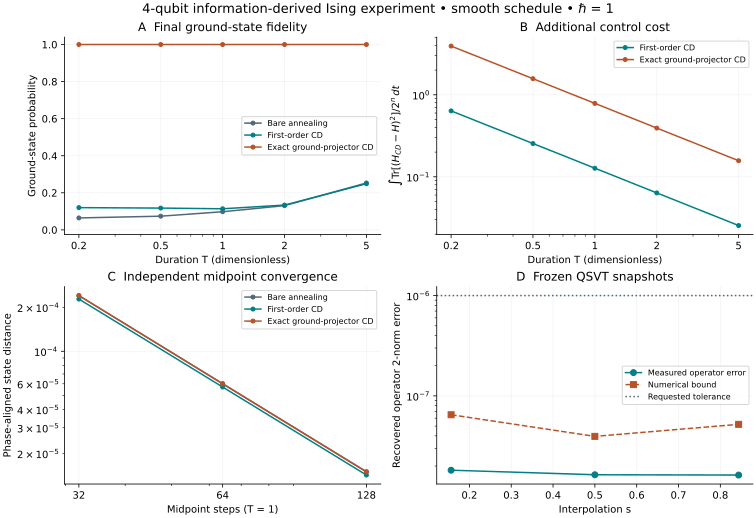
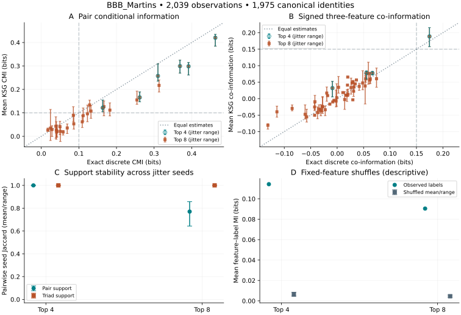

# ADMET feature-Ising quantum-control experiment

A reproducible pipeline from molecular Morgan **counts** to information-screened Ising interactions, a first-order variational counterdiabatic correction, heralded cosine/sine QSVT, and a validated runtime package. Three notebooks expose the chemistry, statistics, Hamiltonian algebra, numerical experiment, and API boundary.

This is a **dimensionless data-derived encoding**, with a chosen energy scale and ℏ = 1. It is not an electronic-structure Hamiltonian, a calibrated ADMET mechanism, or a trained property predictor. The Python experiment runs end to end without Triple Alpha; native Beryllium source remains a separately identified candidate.

## Reproduce

From this directory, with Python 3.11:

```bash
python -m venv .venv
source .venv/bin/activate
python -m pip install -r requirements.txt
python run_checks.py
python run_benchmarks.py --download-bbb
python src/admet_submission_entry.py
```

`run_checks.py` runs scientific/adversarial tests and all three notebooks in fresh kernels using the selected interpreter. The default fixture has public structures and invented labels. `run_benchmarks.py --download-bbb` explicitly downloads the pinned public BBB table, then blocks experiment network connections. No credentials or Triple Alpha calls are involved. For fully offline reproduction, use `--bbb-file /path/to/bbb_martins.tab` instead. Conda setup is also available in `environment.yml`.

| Notebook | Reviewable scientific work |
| --- | --- |
| [Curation](pipeline/ADMET_future_curation_complete.ipynb) | Structure/label validation, count fingerprints, MI/CMI, signed co-information, compact qubits, per-molecule fields, independent classical spin energies |
| [Counterdiabatic control](pipeline/Counter-diabatic%20hamiltonian_complete.ipynb) | Driver/interpolation, commutators, variational AGP, dense references, duration sweep, exact ground-projector control, convergence and control cost |
| [End to end](ADMET_Triple_Alpha_End_to_End.ipynb) | Both QSVT branches, numerical error bound, heralding, direct-exponential comparison, strict runtime package, blocked API preflight |

Each notebook runs independently, without hidden kernel state, positional cell execution, pickle dependencies, automatic installs, or default downloads.

## Measured experiment

The smooth schedule is `s(u)=3u²−2u³`, with `u=t/T`. A four-qubit fixture starts in the unique driver ground state `|+⟩ⁿ`. Bare annealing and the production first-order CD control are compared with an independent exact **ground-projector** reference. Times and control costs use the chosen dimensionless scale.

| Duration T | Bare ground fidelity | First-order CD | Exact ground-projector CD |
| ---: | ---: | ---: | ---: |
| 0.2 | 0.06447 | 0.12004 | ≈1 |
| 0.5 | 0.07393 | 0.11760 | ≈1 |
| 1 | 0.09796 | 0.11388 | ≈1 |
| 2 | 0.13096 | 0.13386 | ≈1 |
| 5 | 0.25305 | 0.24908 | ≈1 |

First-order CD is **not uniformly better**. The result at T=5 remains visible. The exact reference is state-specific, dense, and more costly; it is a numerical calibration, not an efficient implementation claim. Midpoint-exponential refinement checks the adaptive ODE solution at T=1. Three frozen QSVT snapshots have recovered operator errors below 1.9×10⁻⁸ at requested tolerance 10⁻⁶. These snapshots do not implement a time-ordered QSVT anneal.



The pinned official BBB artifact has **2,039 valid observations, 1,975 canonical molecules, 64 duplicate observations, and 10 identities with conflicting labels**. The unique count matches the documentation's stated 1,975 drugs; the report does not assume how that published cohort was processed. All raw rows are retained under the declared exploratory weighting.

| Real-data profile | Active qubits | CD terms | Recovered `expm` error | Numerical bound |
| --- | ---: | ---: | ---: | ---: |
| Top 4 | 4 | 32 | 1.75×10⁻⁸ | 5.73×10⁻⁸ |
| Top 8 | 7 | 55 | 1.81×10⁻⁸ | 5.80×10⁻⁸ |

Both profiles complete the runtime handoff. Across five jitter seeds, top-4 supports are stable; top-8 pair Jaccard ranges **0.643–0.857**, and **20/140** pair-screen decisions disagree with exact discrete CMI. This exposes estimator sensitivity rather than hiding it. Label shuffles are descriptive, with selected features held fixed; they are not significance tests. No threshold is lowered to force interactions, and no held-out prediction claim is made.



Complete measured records, source/data identity, and checksums are in [the benchmark record](results/benchmark_summary.json).

## Method and verification policy

`H₀=−ΣXᵢ`, `Hₚ(θ)=H_A+ΣθᵢZᵢ`, and `H(s)=(1−s)H₀+sHₚ`. Local fields use the selected molecule's scaled **counts**, not MI scores. All retained interactions participate; precision/resource failures raise diagnostics rather than silently pruning terms.

Discrete feature–label MI is in nats; the retained seeded KSG estimates use bits. Screens 0.10/0.15 are heuristic. Positive co-information selects redundancy; negative synergy diagnostics remain visible. Statistics/scaling fit the exploratory table.

Frozen QSVT encodes `β exp(−itH_CD)` with β≈¼, approximately 1/16 heralding probability, and two extra ancillas. Numerical bounds cover polynomial tails, phase reconstruction, and float64 allowance, without interval-proof claims. Register/query counts exclude compiler-dependent workspace and native costs. Strict runtime bundles bind data, settings, versions, source hashes, and independently decoded inputs.

For local data, provide a CSV with `Drug` (SMILES) and binary `Y`:

```bash
python src/admet_submission_entry.py --data-csv /path/to/admet.csv --dataset My_ADMET --sample-index 0 --top-k 4
```

Top-4/top-8 are bounded profiles; the original top-100 configuration remains available subject to budgets. Pinned BBB reproduction needs no PyTDC dependency.

## Extensions with explicit acceptance targets

| Extension | What would establish improvement |
| --- | --- |
| Higher-order or ground-weighted AGP | Rank/conditioning diagnostics, monotone variational residual, transport fidelity **and** control-cost sweeps against the same exact reference |
| Discrete estimators and calibrated screening | Permutation/null calibration, multiplicity policy, duplicate/conflicting-label sensitivity, edge stability, and a declared comparison with the retained KSG baseline |
| Chemical interpretation of count buckets | RDKit atom-environment/bitInfo collision diagnostics; hashed indices are not unique chemical substructures |
| Predictive ADMET readout | Grouped/scaffold train-only fitting, untouched held-out evaluation, uncertainty, and matched classical fingerprint baselines; no reuse of this exploratory fit as a prediction score |
| Time-ordered QSVT and native deployment | Schedule discretization/error accumulation, postselection or amplification cost, compiled gate-convention fixtures, exact source/deployment identity, then an independently verified service contract |

Generated data, caches, historical pickles, credentials, and runtime bundles stay in ignored `artifacts/` or local storage. Only small derived results are published. Candidate QBE protocol v2 requires a fresh verified deployment; an old deployment is incompatible. Live API execution remains blocked until native gates, compilation, deployment identity, and service semantics are verified. Mock tests cover the complete proposed lifecycle and failure paths.

See [VALIDATION.md](VALIDATION.md) for scientific references, acceptance criteria, and remaining limits.
