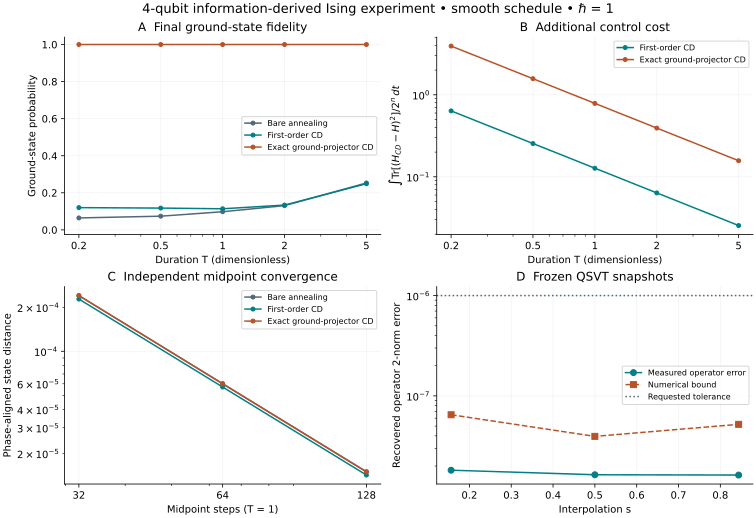

# Quantum Molecular Learning for ADMET

Molecular Morgan **counts** → information-screened Ising interactions → molecule-specific variational counterdiabatic control → heralded cosine/sine QSVT → validated measurement records → binary ADMET readout. Three independent notebooks expose the chemistry, statistics, Hamiltonian algebra, and runtime boundary.

The Hamiltonian is a **dimensionless data-derived encoding**, with a chosen energy scale and ℏ = 1. It is not an electronic-structure Hamiltonian or a calibrated ADMET mechanism. Offline execution, classical baselines, and a post-API learning implementation are available. The public readout awaits measurement records; the public runtime client retains deployment-specific execution guards.

**Private execution confirmation:** The project author confirms an end-to-end hardware run using Horizon Quantum's Triple Alpha workflow. This confirmation strengthens ADMET’s execution signal: **successful private compilation and execution, with proprietary results kept confidential**. Public CI validates the disclosed offline pipeline; it does not reproduce the private hardware run or disclose its results.

## Collaboration and authorship

The reusable Triple Alpha/Beryllium simulation library was co-developed by **Senay Kahsay, Amoy Ashesh, Davide Bincoletto and Javier Sanchez**. The library collaboration covered the broader quantum-simulation implementation.

**Senay Kahsay developed the ADMET application**, including its molecular-data preparation, Hamiltonian/control pipeline and application integration. These credits distinguish the shared library from the application work.

## Reproduce

Use Python 3.11 from this directory:

```bash
python -m venv .venv
source .venv/bin/activate
python -m pip install -r requirements.txt
python run_checks.py
python run_benchmarks.py --download-bbb
```

The benchmark command explicitly acquires the checksum-pinned public BBB table and runs both the preserved exploratory study and the complete supervised all-molecule preparation/classical baselines. Use `--bbb-file /path/to/bbb_martins.tab` for offline reproduction. To prepare separately, run `python run_learning_pipeline.py prepare --bbb-file /path/to/bbb_martins.tab`, or use `--data-csv /path/to/data.csv --endpoint My_ADMET` with `Drug` SMILES and binary `Y`. Experiment connections are denied. No credentials or Triple Alpha requests are required. Generated preparations, molecular records, fitted models, and caches stay in ignored `artifacts/`.

| Notebook | Scientific work |
| --- | --- |
| [Curation](pipeline/ADMET_future_curation_complete.ipynb) | Count fingerprints, MI/CMI, signed co-information, molecular fields, exact classical spin energies; distinction between exploratory and supervised fitting |
| [Counterdiabatic control](pipeline/Counter-diabatic%20hamiltonian_complete.ipynb) | Pauli commutators, variational AGP, independent matrix references, transport ablations, convergence and control cost |
| [End to end](ADMET_Triple_Alpha_End_to_End.ipynb) | Both QSVT branches, numerical bound, heralding, direct-exponential comparison, runtime/result contracts and post-API learning |

Each notebook executes in a fresh kernel. The default structures have invented labels and demonstrate software execution, not predictive accuracy.

## Supervised data and learning

The pinned BBB table has **2,039 rows and 1,975 canonical identities**. The supervised path collapses 54 concordant duplicate rows and quarantines all 20 rows belonging to 10 conflicting-label identities. It retains **1,965 labelled identities** for learning and **all 1,975 valid structures** for measurement/prediction. Conflicting labels are never resolved by majority vote.

A deterministic strict Murcko-scaffold split keeps molecular identities and scaffold groups disjoint, including one shared group for all acyclic molecules. The source-hashed preparation summary records the resulting train/validation/test sizes. Feature selection, information interactions and min/max scaling fit **training only**. The frozen schema binds training labels, feature/wire mapping and readout supports; out-of-range counts are clipped and flagged. All selected features retain local fields, including those without screened interactions.

Every canonical molecule receives a task binding its feature vector, CD coefficients, QSVT phases, normalization, shots, source rows and physical settings. Identical fitted feature vectors may reuse immutable physics bundles; molecule/task/job identities remain distinct. Preparation checks every unique Hamiltonian against a direct matrix exponential within the declared bounded profile.

After a verified deployment returns measurements, supply explicitly mapped, normalized result envelopes:

```bash
python run_learning_pipeline.py train --preparation artifacts/learning/PREPARATION_ID --results /path/to/bound_results.json
python run_learning_pipeline.py predict --model artifacts/trained_readout/correlation_model.json --records /path/to/decoded_records.json
```

The readout uses heralded raw Z single, pair and triad moments. Connected correlations remain diagnostics. Standardized logistic regression fits train only; validation selects regularization; test labels enter only the separate evaluation. Full 1,024-count and selected-count classical baselines use the same split and tuning grid. Reports include ROC AUC, average precision, Brier score, log loss and fixed-threshold classification metrics. Portable JSON models avoid pickle. Synthetic result tests establish software behavior, not quantum ADMET accuracy.

## Scientific scope and measured controls

`H₀=−ΣXᵢ`, `Hₚ(θ)=H_A+ΣθᵢZᵢ`, `H(s)=(1−s)H₀+sHₚ`. The first-order AGP is `A=iα[H,Hₚ−H₀]`, with `α=−‖O₁‖²/‖O₂‖²`. Molecular fields use scaled counts; MI scores select features. Every retained nonzero interaction participates, with explicit precision/resource failures.

Frozen QSVT encodes `β exp(−itH_CD)`, β≈¼, with approximately 1/16 heralding probability and two additional ancillas. Bounds cover polynomial tails, phase reconstruction and float64 allowance; they are not interval proofs. Frozen snapshots do not constitute a time-ordered QSVT anneal.

The four-qubit transport ablation compares bare annealing, first-order CD and exact dense ground-projector control at five durations. First-order CD improves short-duration fidelity but is slightly worse at T=5 (0.24908 versus 0.25305). The exact state-specific reference reaches approximately unit fidelity and its higher control cost remains visible.



The separate **legacy exploratory** BBB study preserves all raw-row weights and the original KSG screens. Its top-8 graph varies across jitter seeds (pair Jaccard 0.643–0.857); 20/140 pair-screen decisions differ from an exact discrete baseline. This is estimator sensitivity, not a validated causal interaction graph or supervised prediction score. MI uses nats; KSG/CMI and co-information use bits. Positive triad co-information selects redundancy; negative synergy diagnostics remain visible. [Measured records](results/benchmark_summary.json) retain source/data identity and negative results.

## SDK and native execution boundary

The optional **Triple Alpha 0.2.3** SDK is tested in a separate environment:

```bash
python -m venv .venv-sdk
.venv-sdk/bin/python -m pip install -r requirements-sdk.txt
.venv-sdk/bin/python verify_sdk_contract.py
```

Socket-blocked comparisons against the installed SDK verify POST operations, URL handling, request models, status fields and named numeric-string inputs. The logical flat runtime stream is not sent directly to the service. Each circuit shape receives candidate fixed-shape Beryllium source with unique input/output names and a hash-bound mapping. Inner result fields require an explicit verified deployment mapping.

Deployment-specific compilation, gate conventions, capacity and output semantics are not independently verified by the public checks. Protocol v2 must be matched to its verified deployment. Live opt-in and all native verification flags are required before execution; SDK mock success does not satisfy them.

## Research extensions

| Extension | Acceptance target |
| --- | --- |
| Higher-order / ground-weighted AGP | Conditioning, residual, fidelity and control-cost sweeps against the same exact reference |
| Calibrated information screens | Discrete-estimator ablations, permutation/multiplicity policy and edge stability on training only |
| Chemical interpretation | RDKit atom-environment collision diagnostics; hashed buckets are not unique fragments |
| Predictive validation | Real results; nonlinear classical controls, zero-time/no-CD readout ablations, repeated scaffold splits and scaffold bootstrap uncertainty; untouched external evaluation |
| Time-ordered QSVT / native execution | Accumulated schedule/postselection cost, compiled gate fixtures and exact deployment/input/output verification |

See [VALIDATION.md](VALIDATION.md) for acceptance criteria, primary references and remaining limits.
